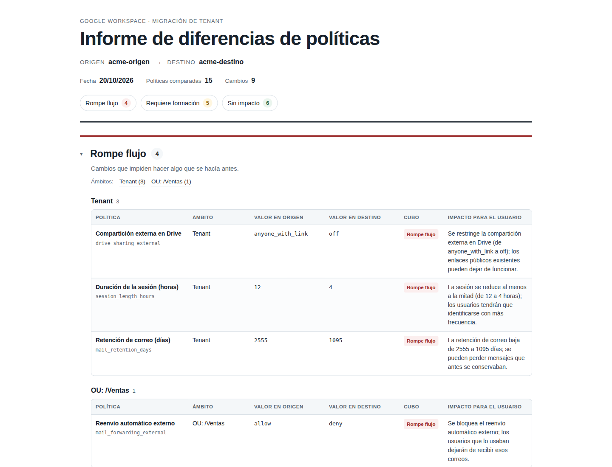

# gam-policy-diff

Compara las políticas de dos tenants de Google Workspace a partir de exportaciones de GAM y genera un informe HTML agrupado por impacto para el usuario.

## Qué problema resuelve

En una migración de Google Workspace, el correo suele llegar; lo que rompe el día D son las políticas que nadie comparó. Retención, compartición en Drive, doble verificación, duración de sesión, aliases, unidades organizativas, calendario y grupos pueden estar configurados de forma distinta en cada tenant y en cada ámbito. gam-policy-diff compara esas políticas por ámbito, las clasifica según el impacto para el usuario y genera un informe que se puede revisar con el cliente.

Ejemplo de migración: una empresa pasa de un tenant con OUs por país a otro con OUs por departamento. La compartición externa está abierta en /Ventas y el destino la cierra a nivel de tenant; además, la retención baja. El informe separa el cierre de la compartición del cambio de retención y permite decidir qué comunicar antes del corte.

## Captura



Informe generado con los fixtures ficticios de `acme-origen` y `acme-destino`. El informe no contiene datos reales.

## Instalación y uso

Necesitas Python 3.11 o superior.

```bash
cd gam-policy-diff
python3 -m venv .venv
source .venv/bin/activate
# En Windows: .venv\Scripts\activate
pip install -e .
gam-policy-diff --demo
```

El comando de demo usa los fixtures incluidos y escribe `report.html` y `report.json` en el directorio actual. Después puedes comparar tus propios ficheros:

```bash
gam-policy-diff --old fixtures/tenant-origen.csv --new fixtures/tenant-destino.csv --out report.html
gam-policy-diff --old tenant-origen.xlsx --new tenant-destino.xlsx --out report.html
```

`--out` es opcional; por defecto se escribe `report.html`. El JSON se guarda al lado del HTML, con el mismo nombre: `--out informes/cliente.html` genera `informes/cliente.json`.

### Formato de entrada

Cada fichero puede ser un CSV, un JSON o un XLSX de `gam export policy`. En CSV y JSON, cada fila es una política y un ámbito. Las columnas mínimas son `policy_id`, `scope_type`, `scope_name` y `value`; `policy_name` y `tenant` son opcionales.

```csv
policy_id,policy_name,scope_type,scope_name,value,tenant
drive_sharing_external,Compartición externa en Drive,OU,/Ventas,anyone_with_link,origen
```

- `scope_type`: `tenant`, `OU`, `group` o `user`.
- `scope_name`: vacío cuando el ámbito es el tenant completo.
- `tenant`: si falta, se usa el nombre del fichero.
- En JSON se acepta una lista de objetos o un objeto con la clave `policies`.

Si tus columnas tienen otros nombres, usa un mapeo con el formato `campo=columna`:

```bash
gam-policy-diff --old origen.csv --new destino.csv \
  --map policy_id=PolicyId,policy_name=Name,scope_type=Scope,scope_name=ScopeName,value=Setting
```

También puedes guardar ese mapeo en un JSON con la misma forma y pasar `--map mapping.json`. El mapeo se aplica a los dos ficheros.

### Exportación XLSX de GAM

El adaptador lee la primera hoja de la exportación ancha de `gam export policy` y convierte solo estos ajustes:

| `setting.type` | `policy_id` | Transformación |
| --- | --- | --- |
| `settings/security.session_controls` | `session_length_hours` | `webSessionDuration` de segundos a horas |
| `settings/gmail.auto_forwarding` | `mail_forwarding_external` | `enableAutoForwarding` a `allow` o `deny` |
| `settings/security.two_step_verification_enforcement` | `enforce_2sv` | `enforcedFrom`: `1970-01-01` es `false`; otra fecha es `true` |
| `settings/drive_and_docs.external_sharing` | `drive_sharing_external` | `externalSharingMode` y `allowedPartiesForDistributingContent` a `off`, `domain` o `anyone_with_link` |

- `/` en `policyQuery.orgUnitPath` se trata como tenant; el resto de rutas, como OU.
- `policyQuery.groupEmail` se trata como grupo.
- El nombre del fichero se usa como etiqueta del tenant. Renombra los XLSX antes de comparar.
- El resto de ajustes de la exportación se ignora.
- `--map` no se aplica a XLSX.
- La lectura del XLSX usa solo la biblioteca estándar; no necesita pandas ni openpyxl.
- Los tests usan un XLSX sintético; la exportación real no se versiona.
- El ajuste de compartición externa de Drive puede quedar superado por las reglas de Trust Rules; el propio export lo advierte. Verifica ese punto en la consola antes de sacar conclusiones.

### Códigos de salida

| Código | Significado |
| --- | --- |
| 0 | Informe generado |
| 1 | Error de entrada (fichero, columnas o datos) o de escritura |
| 2 | No hay diferencias; no se escriben ficheros |

Para ejecutar los tests: `pip install -e ".[dev]"` y luego `pytest`.

## Qué políticas compara y cómo se clasifican

Compara una fila por política y ámbito. La clave es `(policy_id, scope_type, scope_name)`, así que la misma política puede tener valores distintos en el tenant, en una OU o en un grupo. Antes de comparar se normalizan espacios, mayúsculas y booleanos habituales.

Los tres cubos son:

- `rompe_flujo`: el cambio impide hacer algo que se hacía antes.
- `requiere_formacion`: el cambio altera el comportamiento pero no bloquea.
- `sin_impacto`: mismo valor, o diferencia que no afecta al usuario final.

La precedencia es explícita:

1. Solo en origen: `rompe_flujo`, porque el destino pierde una configuración.
2. Solo en destino: `requiere_formacion`, porque hay una configuración nueva que revisar.
3. Mismo valor normalizado: `sin_impacto`.
4. Regla específica de la política.
5. Política sin regla: `requiere_formacion`, con un motivo que lo indica.

En compartición externa, el orden de apertura es `off` < `domain` < `anyone_with_link`; en publicación de grupos, `anyone` < `members` < `owners`.

Las reglas específicas cubren estas políticas:

| policy_id | Política | Criterio |
| --- | --- | --- |
| `mail_retention_days` | Retención de correo (días) | Bajar rompe; subir no tiene impacto |
| `session_length_hours` | Duración de la sesión (horas) | Reducir a la mitad o menos rompe; reducir menos requiere formación; alargar no impacta |
| `drive_sharing_external` | Compartición externa en Drive | Cerrar el nivel rompe; abrirlo requiere formación |
| `drive_default_sharing` | Compartición predeterminada en Drive | Cualquier cambio requiere formación |
| `enforce_2sv` | Exigir verificación en dos pasos | Activarla requiere formación; desactivarla no impacta |
| `calendar_external_invites` | Invitaciones externas de calendario | Cualquier cambio requiere formación |
| `calendar_default_view` | Vista predeterminada del calendario | Cualquier cambio es sin impacto |
| `mail_forwarding_external` | Reenvío automático externo | Cerrarlo rompe; abrirlo requiere formación |
| `alias_domain` | Dominio de alias | Cualquier cambio requiere formación |
| `group_who_can_join` | Quién puede unirse al grupo | Cualquier cambio requiere formación |
| `group_discovery` | Visibilidad del grupo en el directorio | Cualquier cambio es sin impacto |
| `group_external_members` | Miembros externos del grupo | Prohibirlos rompe; permitirlos requiere formación |
| `group_who_can_post` | Quién puede publicar en el grupo | Restringirlo rompe; ampliarlo requiere formación |
| `directory_contact_sharing` | Compartición de contactos del directorio | Cualquier cambio requiere formación |

El adaptador XLSX solo convierte `session_length_hours`, `mail_forwarding_external`, `enforce_2sv` y `drive_sharing_external`; para el resto de políticas usa CSV o JSON normalizado.

Las reglas viven en [rules.py](src/gam_policy_diff/rules.py), en `DECISION_TABLE`. Para añadir una política nueva basta con añadir una entrada; el motor de diferencias no cambia. Cada entrada del informe lleva una frase que explica su clasificación.

## Límites

- No llama a APIs de Google, no pide credenciales y no escribe en el tenant. Trabaja solo con ficheros que ya tienes.
- No genera las exportaciones de GAM. El adaptador XLSX solo convierte los cuatro ajustes de la tabla anterior; para el resto necesitas CSV o JSON normalizado.
- No lee más de una hoja del XLSX ni varios tenants por fichero.
- No calcula la herencia de OU ni expande grupos: compara las filas que recibe. La exportación debe traer el valor efectivo por ámbito.
- No valida los valores contra la API de Google; normaliza y compara texto. Un formato distinto puede necesitar una regla o una normalización adicional.
- No compara usuarios, buzones, mensajes ni contenido. Los nombres de OUs, grupos, dominios, alias y, si usas ese ámbito, usuarios, pueden ser confidenciales.
- No tiene autenticación, base de datos, frontend ni integración directa con GAM.
- No sustituye una prueba en un tenant de staging ni la revisión humana de cada cambio.

> **Datos reales.** No metas exportaciones reales en el repositorio ni las compartas sin autorización y anonimización. La herramienta no las necesita para funcionar. Si pruebas con un tenant real, usa una cuenta dedicada con doble verificación, permisos de solo lectura y revoca el acceso al terminar. No le des credenciales de superadmin a nadie para ejecutar esta herramienta. La CI solo permite los dos CSV ficticios de `fixtures/`; cualquier otro CSV, JSON, XLSX o informe versionado hace fallar el pipeline.

## Cómo se usa en un discovery, en cuatro pasos

1. Define el alcance: tenant, OUs y grupos que afectan al día D. Pide los valores efectivos, no solo los heredados.
2. Exporta con GAM. Si usas el adaptador XLSX, comprueba que los cuatro ajustes cubiertos son los que te interesan; para el resto, normaliza a las seis columnas. Prueba primero `--demo` y después con una copia anonimizada; no uses el repositorio para los datos reales.
3. Ejecuta la comparación y revisa primero `rompe_flujo`. Contrasta cada hallazgo con quien opera el tenant: un cambio puede ser intencionado.
4. Entrega el HTML y usa el JSON para seguimiento. Repite la comparación tras los cambios y conserva la fecha del informe.

## Licencia

MIT. Consulta [LICENSE](LICENSE).
